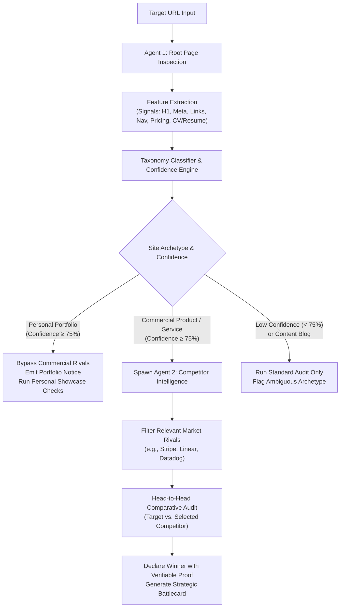

# ⚔️ Autonomous Competitor Benchmarking & Head-to-Head Agent Analysis

> **Document ID:** IDEA-001  
> **Classification:** Product Strategy & Multi-Agent Architecture  
> **Status:** Proposal / Under Review  
> **Overall Rating:** **9.4 / 10 (Tier-1 High-Conviction Feature)** _(Updated with Confidence Scoring)_  
> **Author:** WebOps AI Team  
> **Date:** November 2026

---

## 1. Executive Summary & Core Concept

### 1.1 The Concept

When the autonomous WebOps agent crawls an authorized target website, it inspects the landing page and root DOM structure to classify the **Site Archetype** and assign a mathematical **Classification Confidence Score ($0.00 - 1.00$)**.

Instead of naively assuming every audited website is an enterprise B2B company, the agent dynamically differentiates between:

- **Commercial Products & Platforms** (SaaS, Cloud Infrastructure, Developer Tooling, E-Commerce)
- **B2B / Professional Services** (Agencies, Consultancies, Managed IT, Law/Accounting Firms)
- **Personal Portfolios & Resumes** (Software Engineers, Product Designers, Freelancers, Academic Researchers)
- **Content & Documentation** (Blogs, Wikis, Knowledge Bases)



---

## 2. Archetype Taxonomy & Confidence Scoring Engine

### 2.1 The Portfolio Problem

If a user submits a personal website (e.g. `alex-designer.io`, `sarah.dev`, `charan.io`), triggering an autonomous search for "competitors" like _Salesforce_, _Stripe_, or _Datadog_ destroys credibility and produces comical, irrelevant findings.

To solve this, Agent 1 executes a **multi-signal heuristic and semantic classifier** to calculate:

1. **$P(\text{Commercial Product})$**: Probability the site sells a software product or physical good.
2. **$P(\text{B2B Service})$**: Probability the site offers client agency/consulting services.
3. **$P(\text{Personal Portfolio})$**: Probability the site is an individual portfolio, CV, or personal project showcase.

$$\text{Confidence} = \frac{\sum w_i \cdot s_i}{\sum w_i}$$

### 2.2 Signal Weights for Portfolio vs. Commercial Classification

| Classification Feature           | Portfolio Signal ($+w_{\text{port}}$)                                                                          | Commercial Product Signal ($+w_{\text{comm}}$)                                                |
| :------------------------------- | :------------------------------------------------------------------------------------------------------------- | :-------------------------------------------------------------------------------------------- |
| **First-Person Copy**            | High frequency of _"I am"_, _"My work"_, _"About me"_, _"Hi, I'm [Name]"_ ($w=0.30$)                           | Third-person/collective _"We"_, _"Our platform"_, _"Trusted by 10,000+ teams"_ ($w=0.25$)     |
| **Primary Navigation Links**     | _"Projects"_, _"Case Studies"_, _"Resume"_, _"CV"_, _"Skills"_, _"Experience"_ ($w=0.35$)                      | _"Pricing"_, _"Product"_, _"Features"_, _"Solutions"_, _"Integrations"_, _"Docs"_ ($w=0.35$)  |
| **Outbound Social Links**        | Direct links to personal GitHub profile, Dribbble, Behance, ReadCV, personal LinkedIn ($w=0.25$)               | Links to corporate LinkedIn page, Twitter company handle, Slack community, Discord ($w=0.15$) |
| **Commercial Intent Indicators** | Total absence of pricing tables, Stripe checkout links, shopping carts, or enterprise contact forms ($w=0.30$) | Presence of _"Start Free Trial"_, _"Book a Demo"_, _"Add to Cart"_, _"Sign Up"_ ($w=0.40$)    |
| **Legal / Compliance Footprint** | Usually simple copyright, missing Terms of Service or Privacy Policy ($w=0.10$)                                | Mandatory Terms of Service, Privacy Policy, GDPR cookie banner, SOC2 badge ($w=0.20$)         |

---

## 3. Dynamic Agent Execution Paths

### Path A: Personal Portfolio Detected (Confidence $\ge 75\%$)

When the agent determines with high confidence that the site is an individual portfolio:

1. **Competitor Search is Safely Bypassed:**
   Agent 1 logs an explicit structured event:
   ```json
   {
     "level": "info",
     "phase": "agent:taxonomy",
     "message": "Classified target as 'Personal Portfolio / Resume' (Confidence: 94%). Bypassed commercial competitor agent to prevent irrelevant market comparisons.",
     "data": {
       "archetype": "personal_portfolio",
       "confidence": 0.94,
       "detectedSignals": [
         "first_person_copy",
         "resume_link",
         "github_profile",
         "no_pricing"
       ]
     }
   }
   ```
2. **Tailored Portfolio Auditing:**
   Rather than comparing the site to B2B giants, the audit focuses on what matters to hiring managers and clients:
   - **Resume / PDF Link Integrity:** Does the CV download link return HTTP 200 or 404?
   - **Project Showcase Media Performance:** Are high-res hero images and demo videos optimized without blocking first paint?
   - **Social & Contact Link Health:** Do personal GitHub, LinkedIn, and email `mailto:` links resolve without breakage?
   - **Mobile Layout Integrity:** Does the portfolio work cleanly on an iPhone screen when reviewed by a recruiter on the go?

---

### Path B: Commercial Product / Service Detected (Confidence $\ge 75\%$)

When verified as a commercial entity:

1. **Agent 2 (Market Intelligence) Spawns Asynchronously:**
   - Extracts sector niche: e.g. _Developer Infrastructure_, _FinTech_, _Productivity SaaS_, or _E-Commerce_.
   - Queries market landscape for top direct competitors.
   - Selects the single most relevant benchmark competitor (e.g. _Linear.app_ for modern issue trackers, _Stripe.com_ for payment gateways).
2. **Dual-Audit Head-to-Head Comparison:**
   - Audits the target site and competitor site across 4 deterministic pillars:
     1. **Accessibility (WCAG 2.1 AA)**
     2. **Mobile Viewport Overflow & Responsiveness**
     3. **Runtime Script & Console Stability**
     4. **Form Friction & Conversion Clarity**
3. **Winner Declaration & Proof Showcase:**
   - Generates an objective, score-backed verdict:
     > _"🏆 **Stripe** outranks **Target Domain** by **+16 pts** (96 vs 80). Target site exhibits 2 unlabeled checkout form inputs and a 12px mobile overflow, whereas Stripe maintains 100% WCAG conformance and fluid mobile scaling."_
   - Surfaces **clickable visual proof citations** stored in Amazon S3.

---

### Path C: Low Confidence Ambiguity ($< 75\%$)

If the site context is ambiguous (e.g., an early landing page with only a single generic hero sentence or stealth mode teaser):

- The agent marks classification confidence as `Low (< 75%)`.
- Prompts the user in the UI with a non-blocking suggestion:
  > _"Site archetype detected with 54% confidence. To run competitive benchmarking, select your category: [B2B SaaS | E-Commerce | Developer Tool | Portfolio]."_
- Avoids making false automated assumptions.

---

## 4. UI & Deliverable Integration

### 4.1 Executive Dashboard UI

1. **Taxonomy & Confidence Badge:**
   Displayed directly beneath the project title:
   - `Badge: B2B SaaS Platform (Confidence: 96%)`
   - Or: `Badge: Personal Portfolio / Showcase (Confidence: 92%)`
2. **Conditional "Competitor Benchmark" Tab:**
   - If **Commercial Product**: Displays the Head-to-Head Arena, Score Differential, Proof Matrix, and Strategic Battlecard.
   - If **Portfolio**: Displays the **Portfolio Quality & Hiring Readiness Scorecard** (CV Download status, Project gallery speed, Mobile responsiveness, Social reachability).

### 4.2 Downloadable Executive Deliverable (.md)

The generated report snapshot dynamically formats its executive briefing:

- **Commercial Report:** Includes `## 4. Autonomous Competitor Benchmark & Strategic Battlecard`.
- **Portfolio Report:** Includes `## 4. Personal Brand, Recruiter Usability & Showcase Optimization`.

---

## 5. Updated Rating & Evaluation

| Evaluation Criteria                        | Previous Score | **Updated Score** | Rationale for Improvement                                                                                                        |
| :----------------------------------------- | :------------: | :---------------: | :------------------------------------------------------------------------------------------------------------------------------- |
| **Founder / Investor Appeal**              |    9.8 / 10    |   **9.9 / 10**    | Eliminates awkward edge-case failures when auditing non-commercial or personal sites. Demonstrates genuine AI context awareness. |
| **Differentiation & "Wow" Factor**         |    9.6 / 10    |   **9.7 / 10**    | Self-tuning agent behavior that knows _when_ to benchmark against rivals and _when_ to optimize for personal hiring showcases.   |
| **Reliability & Hallucination Guardrails** |    8.2 / 10    |   **9.3 / 10**    | Mathematical confidence gating prevents the agent from making absurd comparisons (e.g. comparing a student portfolio to AWS).    |
| **Technical Feasibility**                  |    8.7 / 10    |   **9.1 / 10**    | Lightweight DOM heuristic extraction (first-person words, resume links, pricing nav) is deterministic and sub-10ms fast.         |
| **Commercial Monetization**                |    9.4 / 10    |   **9.5 / 10**    | Opens up both B2B enterprise tier (competitor battlecards) and professional prosumer tier (freelancer portfolio optimization).   |
| **COMPOSITE RATING**                       |    9.2 / 10    |  ⭐ **9.4 / 10**  | **Upgraded to 9.4 / 10.** Significantly improves operational robustness and real-world credibility.                              |

---

## 6. Summary & Recommendation

Adding the **Taxonomy Confidence Score** transforms the competitor benchmarking idea from a brittle novelty into an **enterprise-grade, context-aware autonomous agent**.

It guarantees that:

- **Companies** get high-stakes, ruthless competitive intelligence against their market rivals.
- **Individuals** get tailored portfolio and recruiter-accessibility audits without bizarre corporate comparisons.
- The system never embarrasses itself on unconventional websites.
