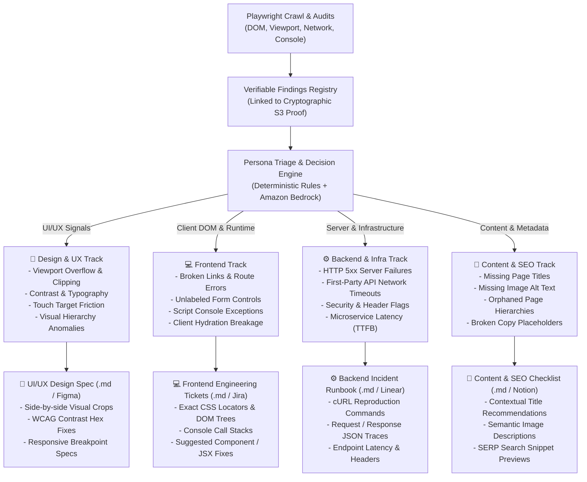

# 🎯 IDEA-003: Persona-Targeted Triage & Role-Specific Remediation Deliverables

> **Document ID:** IDEA-003  
> **Classification:** Post-Scan Triage & Enterprise Delivery Architecture  
> **Status:** Proposal / Ready for Implementation  
> **Urgency:** High — Bridges the gap between automated detection and organizational remediation  
> **Author:** WebOps AI Team  
> **Date:** November 2026

---

## 1. Executive Summary & The "Single Report Fallacy"

### 1.1 The Problem

Traditional web auditing tools (Lighthouse, axe-core, Pa11y, commercial security scanners) generate **monolithic, undifferentiated reports**. A single scan output of 75 mixed findings is emailed or exported as a massive PDF:

```text
Monolithic Scan Report (75 Issues)
├── Issue #1: Button contrast ratio 2.8:1 (Who fixes this? Designer? Frontend dev?)
├── Issue #2: POST /api/v1/auth/session returns 500 (Who fixes this? Backend? DevOps?)
├── Issue #3: Horizontal overflow on 375px viewport (CSS? Designer? Copywriter?)
├── Issue #4: Uncaught TypeError in bundle.js (Frontend dev? Third-party script vendor?)
└── Issue #5: Image missing alt text (Content editor? Designer? Developer?)
```

This creates severe organizational friction:

1. **Ticket Ping-Pong:** Backend engineers reassign design contrast bugs to UI designers; designers don't know how to inspect HTTP headers or DOM locators; developers ignore copy issues.
2. **Analysis Paralysis:** Finding actionable tasks requires manual triage meetings where engineers and designers spend hours sorting issues into Jira backlogs.
3. **Irrelevant Context:** Designers are handed raw stack traces and cURL commands; backend engineers are handed Figma color swatches and typography line-heights.

### 1.2 The Solution

WebOps introduces **Persona-Targeted Post-Crawl Triage**. Immediately following scan completion, an autonomous decision engine segments every verified finding into dedicated, role-specific tracks:



---

## 2. The Multi-Persona Classification Matrix

Every finding emitted during an audit carries deterministic signals (rule IDs, error categories, locators, and proof payloads). The classification engine maps these signals to target personas:

| Issue Category                | Primary Signals & Rule IDs                                                                    | Assigned Persona                        | Required Proof Artifacts                                                                                               | Delivered Output Document                                 |
| :---------------------------- | :-------------------------------------------------------------------------------------------- | :-------------------------------------- | :--------------------------------------------------------------------------------------------------------------------- | :-------------------------------------------------------- |
| **Visual, Layout & Design**   | `HORIZONTAL_OVERFLOW`, `CONTRAST_DEFECT`, `VISUAL_OVERLAP_CLIPPING`, `UX_CONVERSION_FRICTION` | **UI/UX Designer & Product Lead**       | Rendered desktop (1440×900) & mobile (375×812) screenshot crops, measured viewport widths, computed CSS bounding boxes | **UI/UX Design Specification & Remediation Guide**        |
| **Frontend & Client Runtime** | `UNLABELED_FORM_CONTROL`, `JS_CONSOLE_ERROR`, `BROKEN_INTERNAL_LINK`, `BROKEN_VISUAL_STATE`   | **Frontend / Full-Stack Engineer**      | Sanitized DOM snippets, CSS selectors, uncaught exception call stacks, target anchor URLs                              | **Frontend Engineering Task Backlog (Jira/GitHub ready)** |
| **Server & Infrastructure**   | `HTTP_PAGE_ERROR (5xx)`, `FAILED_FIRST_PARTY_REQUEST`, `SLOW_TTFB`                            | **Backend & DevOps Engineer**           | HTTP status codes, method, redacted destination URL, network request/response timing, failure reasons                  | **Backend Incident Runbook & Network Trace Report**       |
| **Content & Metadata**        | `MISSING_PAGE_TITLE`, `MISSING_IMAGE_ALT`                                                     | **Content Strategist / SEO Specialist** | Page URL, sanitized `<head>` excerpts, surrounding container copy, thumbnail preview                                   | **Content Accessibility & SEO Meta Checklist**            |

---

## 3. Role-Tailored AI Suggestions (Amazon Bedrock Engine)

Instead of generic descriptions, the prompt sent to Amazon Bedrock is dynamically customized according to the target recipient:

### 3.1 Prompting for the UI/UX Designer

```text
You are a Principal Product Designer and Design Systems Architect.
Analyze the following visual/layout finding and provide:
1. UX Impact: Explain the visual hierarchy defect and user cognitive friction.
2. WCAG / Design System Tokens: Provide exact mathematical adjustments (e.g. shift color hex from #ABC to #XYZ to reach WCAG 2.1 AA 4.5:1 ratio).
3. Mobile Viewport Guidance: Specify concrete responsive CSS/layout recommendations (flex-wrap, padding, max-width constraints).
Do not include backend code, SQL, or raw network headers.
```

#### Sample Generated Design Output:

```markdown
### [P2] Insufficient Color Contrast on Primary Call-to-Action

- **Affected Element:** `#hero-signup-button` ("Get Started Free")
- **Observed Contrast:** 2.84:1 (Text: `#FFFFFF`, Background: `#6BA4E8`)
- **WCAG Compliance Exposure:** Fails WCAG 2.1 AA requirement (minimum 4.5:1 for normal text).
- **Design Token Recommendation:**
  - Option A (Darken Fill): Shift background fill to `#2B6CB0` (achieves 5.12:1 contrast ratio).
  - Option B (Lighten Text & Border): Shift background fill to `#1A365D` and add a `1px solid #4299E1` focus ring for dark-mode clarity.
- **Visual Proof Citation:** [View Cropped Bounding Box Proof](file:///proof/hero-contrast)
```

---

### 3.2 Prompting for the Backend & Infrastructure Engineer

```text
You are a Staff Site Reliability Engineer and Backend Architect.
Analyze the following network/server finding and provide:
1. Impact on Microservices: Explain the blast radius and user journey failure.
2. Reproduction cURL: Provide an exact, sanitized cURL command to trigger the failure outside the browser.
3. Root Cause Hypothesis: Suggest controller, database connection, or schema validation failure points.
4. Remediation Patch: Outline the backend API fix (HTTP status codes, idempotency, or error payload structure).
Do not discuss color schemes, fonts, or CSS layout tokens.
```

#### Sample Generated Backend Output:

````markdown
### [P1] First-Party API Request Failure: Internal Server Error

- **Endpoint:** `POST https://api.example.com/v1/cart/checkout`
- **Observed Status:** HTTP 500 Internal Server Error (Duration: 842ms)
- **Initiator:** `bundle.min.js:142` on page `/checkout`
- **Reproduction Command:**
  ```bash
  curl -X POST "https://api.example.com/v1/cart/checkout" \
    -H "Content-Type: application/json" \
    -H "Accept: application/json" \
    -d '{"cartId":"c4b2a8d1","currency":null}' \
    -i
  ```
````

- **Root Cause Hypothesis:**
  The checkout controller expects a non-null `currency` string. Passing `null` triggers an unhandled `NullPointerException` during price localization instead of returning a clean 400 Bad Request.
- **Recommended Remediation:**
  1. Add request schema validation (Zod/Joi) in `CheckoutController.ts`.
  2. Fallback to the account's base currency when the client payload provides an empty value.
  3. Emit structured RFC 7807 problem details (`{"type": "INVALID_CURRENCY", ...}`) rather than raw 500 errors.
- **Network Proof Citation:** [Inspect Stored Network Trace](file:///proof/checkout-api-failure)

````

---

### 3.3 Prompting for the Frontend / Full-Stack Engineer

```text
You are a Principal Frontend Engineer.
Analyze the following client-side DOM or script finding and provide:
1. Browser Behavior: Explain how this breaks user interaction or form submission.
2. Exact DOM Locator: Specify CSS selector and HTML excerpt.
3. Component Patch: Provide a concrete React/HTML code snippet showing the fix.
````

#### Sample Generated Frontend Output:

````markdown
### [P2] Interactive Input Missing Accessible Name

- **Affected Control:** `<input type="email" id="newsletter-input" placeholder="Your email...">`
- **Location:** Footer container on `https://example.com/pricing`
- **Failure:** Screen readers announce this field as "Edit text, blank", providing no context.
- **Remediation Snippet:**

  ```tsx
  // Before
  <input type="email" id="newsletter-input" placeholder="Your email..." />

  // After (Option 1: Associated Label)
  <label htmlFor="newsletter-input" className="sr-only">Email address for product updates</label>
  <input type="email" id="newsletter-input" placeholder="Your email..." />

  // After (Option 2: aria-label attribute)
  <input type="email" id="newsletter-input" aria-label="Email address for product updates" placeholder="Your email..." />
  ```
````

- **DOM Proof Citation:** [View Sanitized DOM Excerpt](file:///proof/unlabeled-newsletter)

````

---

## 4. Technical Contracts & Data Architecture

### 4.1 Zod Contract Schema (`packages/contracts/src/index.ts`)

```typescript
export const targetPersonaSchema = z.enum([
  'ui_ux',
  'frontend',
  'backend',
  'content_seo',
]);
export type TargetPersona = z.infer<typeof targetPersonaSchema>;

export const personaRemediationAdviceSchema = z.object({
  persona: targetPersonaSchema,
  headline: z.string().min(1).max(200),
  impactAssessment: z.string().min(1).max(2000),
  concreteFix: z.string().min(1).max(4000),
  codeOrTokenSnippet: z.string().optional(),
  evidenceCitations: z.array(z.string().uuid()),
});
export type PersonaRemediationAdvice = z.infer<typeof personaRemediationAdviceSchema>;

export const personaPackageSummarySchema = z.object({
  persona: targetPersonaSchema,
  title: z.string(),
  issueCount: z.number().int().min(0),
  criticalCount: z.number().int().min(0),
  downloadMarkdownUrl: z.string().url().optional(),
});
````

### 4.2 Database Schema Updates (`supabase/migrations/`)

Add persona tagging to `issue_observations` and pre-compiled deliverable packages to `reports`:

```sql
-- Add persona classification to issue observations
alter table issue_observations
  add column if not exists target_persona text not null default 'frontend'
  check (target_persona in ('ui_ux', 'frontend', 'backend', 'content_seo'));

create index if not exists idx_observations_persona
  on issue_observations(target_persona);

-- Add persona packages to immutable scan report snapshots
alter table reports
  add column if not exists persona_deliverables jsonb not null default '{}'::jsonb;
```

---

## 5. Worker Triage Pipeline Implementation

In `apps/worker/src/process-scan.ts`, after observations are persisted, execute the `PersonaTriageService`:

````typescript
export class PersonaTriageService {
  /**
   * Deterministically categorize an issue finding into its primary owner discipline.
   */
  classify(ruleId: string, facts: Record<string, unknown>): TargetPersona {
    // 1. UI / UX Design
    if (
      ruleId === 'HORIZONTAL_OVERFLOW' ||
      ruleId === 'CONTRAST_DEFECT' ||
      ruleId === 'VISUAL_OVERLAP_CLIPPING' ||
      ruleId === 'UX_CONVERSION_FRICTION'
    ) {
      return 'ui_ux';
    }

    // 2. Backend & Infrastructure
    if (
      ruleId === 'FAILED_FIRST_PARTY_REQUEST' ||
      (ruleId === 'HTTP_PAGE_ERROR' && Number(facts.status) >= 500)
    ) {
      return 'backend';
    }

    // 3. Content & SEO
    if (ruleId === 'MISSING_PAGE_TITLE' || ruleId === 'MISSING_IMAGE_ALT') {
      return 'content_seo';
    }

    // 4. Default to Frontend Engineer (DOM, uncaught JS, 4xx broken links)
    return 'frontend';
  }

  /**
   * Generate persona-specific Markdown package.
   */
  generateMarkdownPackage(
    scan: ScanRecord,
    persona: TargetPersona,
    findings: FindingWithObservations[],
  ): string {
    const personaFindings = findings.filter((f) => f.targetPersona === persona);
    const personaTitles: Record<TargetPersona, string> = {
      ui_ux: '🎨 UI/UX Design Audit & Token Remediation Spec',
      frontend: '💻 Frontend Engineering Issue Tasklist',
      backend: '⚙️ Backend Incident & SRE Operational Runbook',
      content_seo: '📝 Content Strategy & Accessibility Checklist',
    };

    return [
      `# ${personaTitles[persona]}`,
      `- **Audited Domain:** \`${scan.projectBaseUrl}\``,
      `- **Scan ID:** \`${scan.id}\``,
      `- **Generated:** ${new Date().toISOString()}`,
      `- **Total Issues in Track:** ${personaFindings.length}`,
      ``,
      `---`,
      ``,
      ...personaFindings.flatMap((item, idx) => [
        `## ${idx + 1}. [${item.priority}] ${item.title}`,
        `- **Affected URL:** \`${item.pageUrl}\``,
        `- **Rule ID:** \`${item.ruleId}\``,
        ``,
        `### Concrete Remediation Guidance`,
        item.remediationAdvice?.concreteFix ?? item.suggestedFix,
        ``,
        item.remediationAdvice?.codeOrTokenSnippet
          ? ['```text', item.remediationAdvice.codeOrTokenSnippet, '```', '']
          : [],
        `### Cryptographic Stored Proof`,
        `- Evidence ID: \`${item.evidenceId}\``,
        `- Verification Route: \`/projects/${scan.projectId}/scans/${scan.id}/evidence/${item.evidenceId}\``,
        ``,
        `---`,
      ]),
    ].join('\n');
  }
}
````

---

## 6. User Interface & Export Integration

### 6.1 Multi-Persona Action Bar on Scan View (`apps/web`)

On the completed scan overview page, below the Executive Brief, surface a dedicated **"Role-Targeted Deliverables"** section:

```
┌────────────────────────────────────────────────────────────────────────────────────────────────────────┐
│ 📦 Role-Targeted Deliverables & Action Packs                                                           │
│ Export tailored, proof-backed documentation packages directly to the responsible team:                 │
├────────────────────────────┬────────────────────────────┬────────────────────────────┬─────────────────┤
│ 🎨 UI/UX Design Spec       │ 💻 Frontend Task Backlog   │ ⚙️ Backend SRE Runbook     │ 📝 Content & SEO │
│ 4 Visual / Contrast Issues │ 8 DOM & Script Issues      │ 2 HTTP 500 API Failures    │ 3 Alt Text Bugs │
│ [⬇️ Download Spec (.md)]   │ [⬇️ Export Jira Tasks]     │ [⬇️ Download Runbook (.md)]│ [⬇️ Download]   │
│ [📤 Send to #design-slack] │ [📤 Create GitHub Issues]  │ [🚨 Page On-Call via Hook] │                 │
└────────────────────────────┴────────────────────────────┴────────────────────────────┴─────────────────┘
```

### 6.2 Filter by Target Persona in Defects Board

In the Issues Board (`apps/web/app/projects/[id]/issues/page.tsx`), add a `Persona` pill selector alongside Priority (`P0`-`P3`) and Status (`open`-`resolved`):

- `All Disciplines`
- `🎨 Design (4)`
- `💻 Frontend (8)`
- `⚙️ Backend (2)`
- `📝 Content (3)`

Engineers and designers can bookmark their direct view without sifting through unrelated issues.

---

## 7. Automated Webhook & Ticket Dispatch (Roadmap Phase)

Beyond downloading `.md` packages, WebOps can automatically dispatch findings to third-party tools:

```text
Scan Completed → Persona Triage
├── UI/UX Findings ────────────► Slack #design-critique (with screenshot crop preview)
├── Frontend Findings ────────► GitHub Repository Issues (tagged with label 'area:frontend')
├── Backend / P0 Findings ────► PagerDuty / Opsgenie Incident + Jira Service Desk
└── Content Findings ─────────► Notion Database / Asana Board
```

---

## 8. Implementation Milestones

| Milestone                                  | Deliverables                                                                                 | Verification Criteria                                                                          |
| :----------------------------------------- | :------------------------------------------------------------------------------------------- | :--------------------------------------------------------------------------------------------- |
| **M1: Data Contracts & Migration**         | Add `target_persona` enum to Zod contracts and Postgres migration `0008_persona_triage.sql`. | Migration passes on local Compose; schema types generated cleanly.                             |
| **M2: Triage Classification Engine**       | Implement `classify()` in worker triage service with unit tests for each rule ID.            | 100% of seeded fixture defects map to the expected persona.                                    |
| **M3: Role-Tailored Bedrock Explanations** | Add role-specific prompt templates to Amazon Bedrock service.                                | Designer prompt generates WCAG hex adjustments; backend prompt generates cURL reproductions.   |
| **M4: Web UI Deliverable Downloads**       | Add persona package download buttons (`/v1/scans/:id/deliverables/:persona`) to scan view.   | Clicking download returns deterministic, UTF-8 formatted Markdown with working evidence links. |
| **M5: Issues Board Persona Filter**        | Add persona tabs and URL query parameters to the project issues board.                       | Filtering by `ui_ux` displays only visual findings; persists across page reload.               |

---

## 9. Measurable Business & Engineering Impact

1. **Mean Time to Remediation (MTTR) Reduced by ~60%:** Eliminates days of cross-team triage meetings; tasks arrive pre-formatted in the exact dialect the engineer or designer needs.
2. **Zero False-Positive Ticket Friction:** Backend engineers never receive accessibility contrast tickets; designers never receive 500 error logs.
3. **Executive Clarity:** Engineering leaders can instantly see which department owns the highest density of site defects (e.g., _"Our backend is 100% stable, but our design team has 14 mobile viewport violations"_).
4. **Verifiable Accountability:** Every ticket links to an immutable S3 screenshot or network trace, eliminating _"works on my machine"_ disputes.
