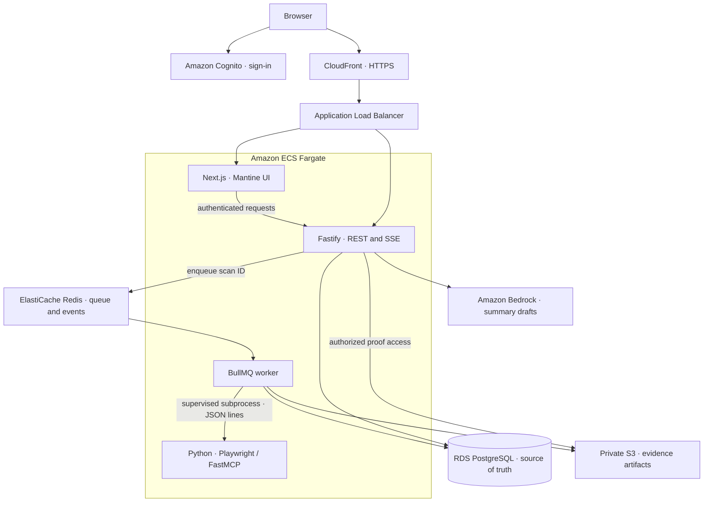
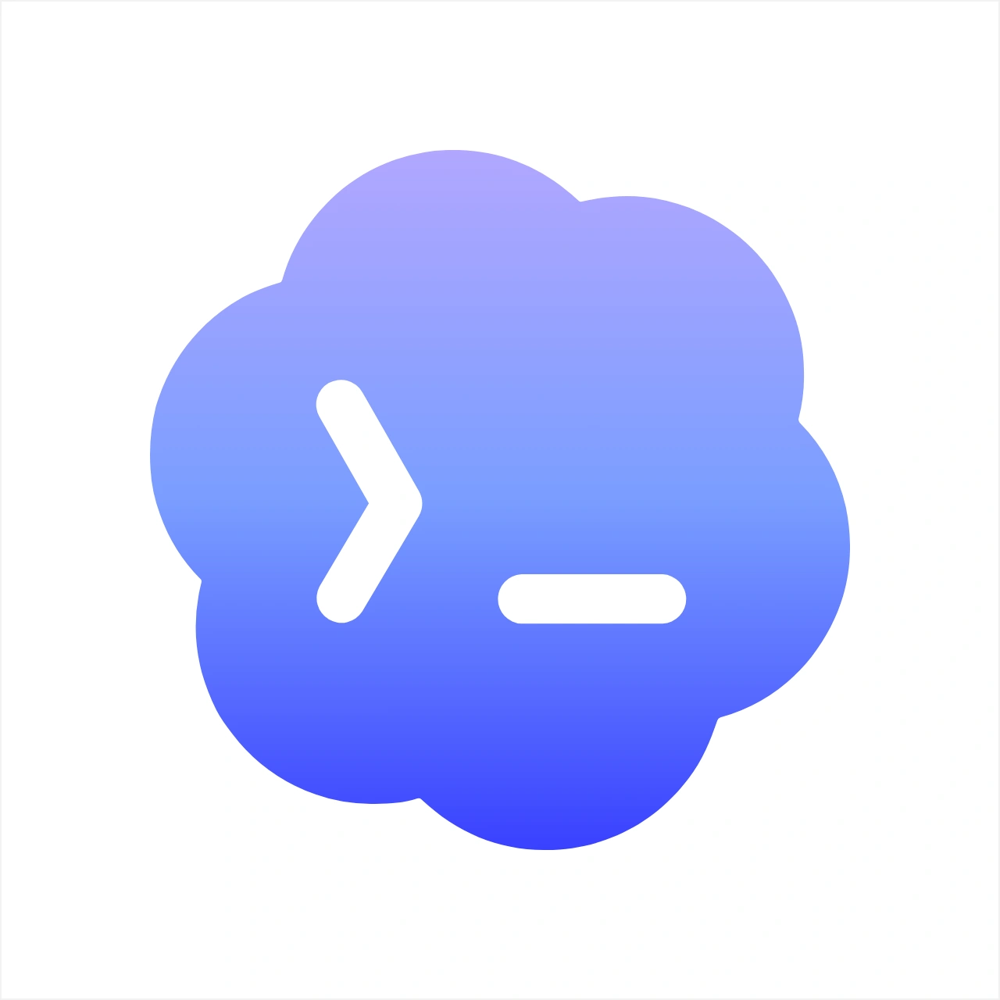
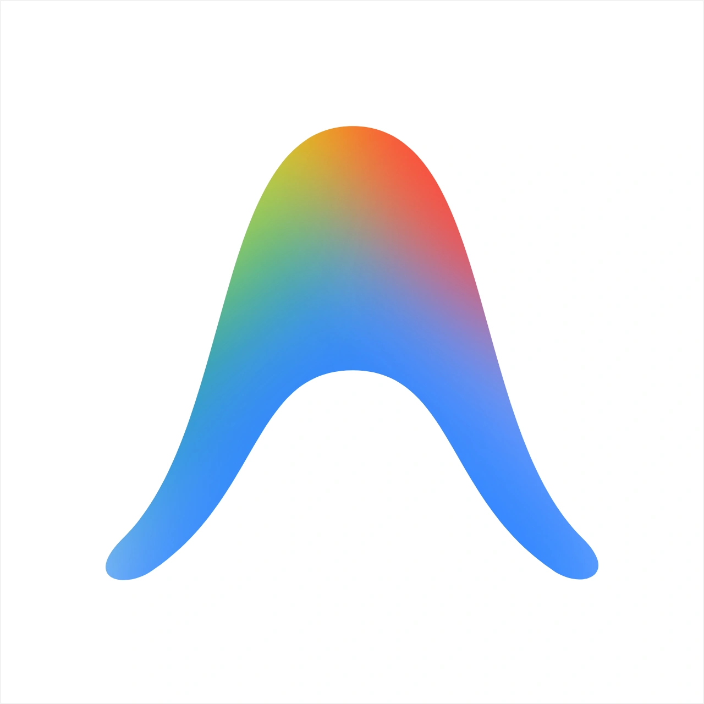

# WebOps Agent

## Overview

WebOps audits websites you own or are authorized to test. It turns browser observations into editable issues with evidence, live scan logs, and historical reports.

[Open the app](https://d33zu6s8ozyktq.cloudfront.net) · [Implementation contract](AGENTS.md)

<details>
<summary>Run locally</summary>

Requires Node.js 22+, pnpm 10.34.9, Python 3.12, uv 0.8.17, and Docker.

```sh
cp .env.example .env
cp apps/web/.env.local.example apps/web/.env.local
# Configure Cognito IDs in both environment files before continuing.
docker compose up -d postgres redis fixture
corepack pnpm install --frozen-lockfile
(cd services/scanner && uv sync --frozen && uv run playwright install chromium)
corepack pnpm dev
```

Open `http://localhost:3000`, sign in, and create a project for `http://localhost:8080/index.html`. Approve `http://localhost:8080` and start a scan. This local-origin exception is development-only.

For AWS deployment, use the [CloudFormation template](infra/aws/cloudformation.yaml) and [deployment script](scripts/deploy-aws.sh). Production updates should use immutable ECR image tags and retain unchanged stack parameters. Set `WEB_ORIGIN` to the public site origin; verify `/health` and browser-origin preflight requests after rollout.

</details>

## Features

- **Bounded scans:** approved origins, crawl limits, robots.txt handling, and cancellation.
- **Evidence-backed issues:** page/link failures, JavaScript errors, failed requests, accessibility checks, and mobile overflow.
- **Developer workspace:** terminal logs during scanning; paginated findings, pages, skipped URLs, and limitations afterward.
- **Issue management:** editable titles, descriptions, priorities, and statuses, with revision history and Markdown exports.
- **Reports and sharing:** immutable scan snapshots, discipline-specific downloads, Discord dispatch, and webhook settings.
- **AI drafts:** Bedrock prioritizes saved findings; drafts reuse recorded facts and evidence, with a deterministic fallback.

## Architecture



Code lives in `apps/{web,api,worker}`, `services/scanner`, and `packages/contracts`. Zod, Pydantic, and a versioned scanner protocol keep boundaries typed.

## Working Process Pipeline

**Create project → approve origins → queue scan → crawl → run checks → store evidence → update issues → snapshot report**

Example using the local fixture; IDs below are illustrative:

| Step     | Sample data / result                                                                |
| -------- | ----------------------------------------------------------------------------------- |
| Scope    | Base: `http://localhost:8080/index.html`; approved origin: `http://localhost:8080`  |
| Queue    | API creates scan `scan-001`; BullMQ receives its ID                                 |
| Inspect  | Browser finds a link from `/index.html` to `/missing.html`                          |
| Check    | Destination returns `404`; rule: `BROKEN_INTERNAL_LINK`                             |
| Evidence | Store the source DOM locator and destination response as `evidence-001`             |
| Issue    | Publish a P1 issue with reproduction steps, suggested fix, and proof link           |
| Report   | Save the issue snapshot and exact coverage; later board edits preserve this history |

Only persisted proof can become a citation. Interrupted or insufficiently covered scans retain an incomplete status.

## Evals

| Area                 | What is checked                                                                                       |
| -------------------- | ----------------------------------------------------------------------------------------------------- |
| Policy and safety    | Origin validation, SSRF restrictions, project authorization, and safe form behavior                   |
| Findings and history | Expected fixture defects, proof links, stable fingerprints, edits, exports, and report snapshots      |
| Reliability and AI   | Retry behavior, event replay, tab locking, invalid model output, timeouts, and deterministic fallback |

```sh
corepack pnpm typecheck
corepack pnpm test
(cd services/scanner && uv run python -m unittest discover -s tests -v)
# Integration gates: requires the local database, Redis, fixture, and .env.
node --env-file=.env scripts/test-gates.mjs all
```

Database integration suites are opt-in; skipped suites do not establish a passing gate. The [benchmark target list](tests/dataset/benchmark_sites.json) is evaluation input, not a published accuracy score or permission to scan those sites.

## Known Limitations

- Login, CAPTCHA, blocked resources, budgets, and timeouts can limit coverage. Zero findings does not establish full-site compliance.
- Authenticated scans are not supported; form submission is blocked by default.
- Visual heuristics can produce false positives and need human review.
- AI drafts prioritize existing findings; they do not independently verify fixes. Draft caches are temporary, and PDF export uses the browser print dialog.
- Production hardening remains open, including filtering egress, secret management, database roles, and encryption/backup controls. See Phase 5 in [AGENTS.md](AGENTS.md).

## Contributors

-  **Codex** — implementation, UI refinement, tests, and deployment support.
-  **AntiGravity Agents** — project implementation and iteration.
