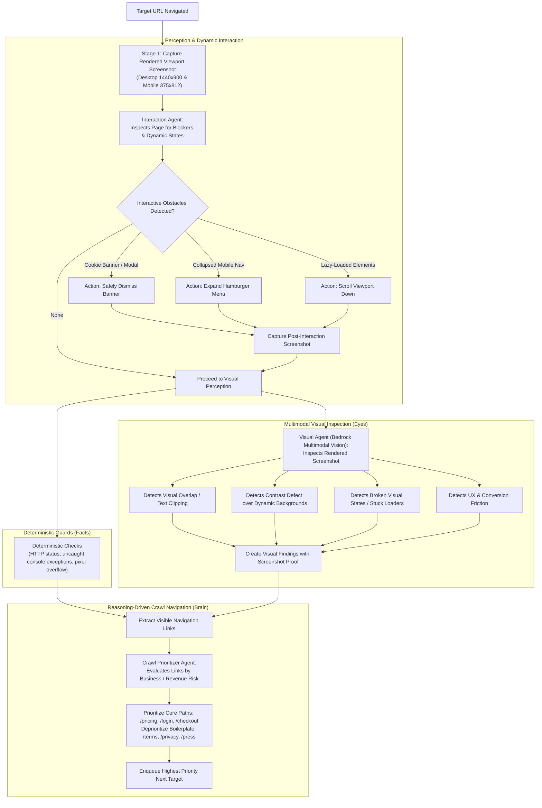

# ⚡ 4-Hour Autonomous Agent Transformation Sprint Plan

> **Sprint Objective:** Transform WebOps from a deterministic web crawler with post-hoc LLM text decoration into a **true autonomous visual and interactive AI agent** that perceives rendered screenshots, interacts with dynamic page states, and navigates with reasoning.  
> **Start Time:** 08:00 AM IST  
> **Target Completion:** 12:00 PM IST (4 Hours)  
> **Status:** ACTIVE EXECUTION

---

## 1. High-Level Hour-by-Hour Timeline

```text
┌─────────────────┬───────────────────────────────────────────────────────────────┐
│ Time Window     │ Milestone & Deliverables                                      │
├─────────────────┼───────────────────────────────────────────────────────────────┤
│ Hour 1 (08:00 - │ Foundation: Contracts, Protocols & Multimodal Visual Agent   │
│ 09:00 AM)       │ - Expand rule IDs in `@webops/contracts` & `protocol.py`      │
│                 │ - Implement `visual_agent.py` (Bedrock Vision analysis)       │
│                 │ - Update worker proof validator for visual evidence           │
├─────────────────┼───────────────────────────────────────────────────────────────┤
│ Hour 2 (09:00 - │ Interactive Exploration Agent & State Handling               │
│ 10:00 AM)       │ - Implement `interaction_agent.py` (cookie banners, menus)    │
│                 │ - Safe bounded non-destructive actions (max 3/page)          │
│                 │ - Re-screenshot after interactions to audit revealed content  │
├─────────────────┼───────────────────────────────────────────────────────────────┤
│ Hour 3 (10:00 - │ Smart Crawl Prioritizer & Runner Integration                  │
│ 11:00 AM)       │ - Implement `crawl_prioritizer.py` (risk-based link ranking)  │
│                 │ - Wire Perception-Reason-Action loop into `runner.py`         │
│                 │ - Emit agent thought events (`agent:vision`, `agent:action`)   │
├─────────────────┼───────────────────────────────────────────────────────────────┤
│ Hour 4 (11:00 - │ UI Visualization, Deliverables & End-to-End Verification      │
│ 12:00 PM)       │ - UI: Visual findings badge, interactive action chips         │
│                 │ - Update Executive Deliverable (.md) with visual audit matrix │
│                 │ - End-to-end smoke test against fixture & real-world target   │
│                 │ - Typechecks (`tsc --noEmit`) and formatting verification     │
└─────────────────┴───────────────────────────────────────────────────────────────┘
```

---

## 2. Core Architecture: The Perception-Reason-Action Loop



---

## 3. Detailed Component Specifications

### 3.1 New Visual Agent Rule IDs

We expand `@webops/contracts`, `services/scanner/scanner/protocol.py`, and `apps/worker/src/validate-finding.ts` to support 4 new visual findings:

1. **`VISUAL_OVERLAP_CLIPPING`**
   - **Trigger:** Rendered elements visually collide, obscure typography, or truncate key action buttons.
   - **Required Proof:** Rendered full or cropped screenshot with bounding box coordinates.
   - **Severity:** P1 or P2.

2. **`CONTRAST_DEFECT`**
   - **Trigger:** Text fails WCAG AA readability standards over dynamic backgrounds, gradients, or photography where static CSS selectors cannot compute single color values.
   - **Required Proof:** Rendered screenshot crop highlighting unreadable text area.
   - **Severity:** P2.

3. **`UX_CONVERSION_FRICTION`**
   - **Trigger:** Essential call-to-action is visually buried, obstructed by competing banners, or exhibits severe visual clutter.
   - **Required Proof:** Viewport screenshot showing high-friction area.
   - **Severity:** P3.

4. **`BROKEN_VISUAL_STATE`**
   - **Trigger:** Infinite loading skeleton, unresolved asset placeholder, or visually broken layout container without a throwing JavaScript error.
   - **Required Proof:** Viewport screenshot capturing the broken component state.
   - **Severity:** P1.

---

### 3.2 Component Implementation Matrix

| File Path                                            | Component                    | Responsibility                                    |   Status   |
| :--------------------------------------------------- | :--------------------------- | :------------------------------------------------ | :--------: |
| `packages/contracts/src/index.ts`                    | **Contracts**                | Add new visual rule IDs to `scannerFindingSchema` | ⏳ Pending |
| `services/scanner/scanner/protocol.py`               | **Protocol**                 | Update `FindingPayload.rule_id` Literal           | ⏳ Pending |
| `apps/worker/src/validate-finding.ts`                | **Worker Validation**        | Validate screenshot proof for visual findings     | ⏳ Pending |
| `services/scanner/scanner/visual_agent.py`           | **Visual Perception Agent**  | Multimodal Bedrock vision audit on screenshots    | ⏳ Pending |
| `services/scanner/scanner/interaction_agent.py`      | **Interactive Explorer**     | Bounded click/scroll/dismiss dynamic states       | ⏳ Pending |
| `services/scanner/scanner/crawl_prioritizer.py`      | **Smart Navigation**         | Risk-weighted link prioritization queue           | ⏳ Pending |
| `services/scanner/scanner/runner.py`                 | **Crawler Loop Integration** | Connect Perception-Reason-Action pipeline         | ⏳ Pending |
| `apps/web/app/projects/[id]/scans/[scanId]/page.tsx` | **Frontend UI**              | Visual findings chips, interaction timeline       | ⏳ Pending |

---

## 4. Execution Step Checklist

- [ ] **Step 1:** Update `packages/contracts/src/index.ts` with new visual rule IDs and build contracts.
- [ ] **Step 2:** Update `services/scanner/scanner/protocol.py` with matching rule IDs.
- [ ] **Step 3:** Update `apps/worker/src/validate-finding.ts` to accept visual findings backed by screenshots.
- [ ] **Step 4:** Create `services/scanner/scanner/visual_agent.py` with Bedrock Vision prompt and fallback heuristics.
- [ ] **Step 5:** Create `services/scanner/scanner/interaction_agent.py` with safe cookie dismissal, mobile nav toggle, and scroll.
- [ ] **Step 6:** Create `services/scanner/scanner/crawl_prioritizer.py` with semantic link scoring.
- [ ] **Step 7:** Integrate all three agents into `services/scanner/scanner/runner.py`.
- [ ] **Step 8:** Update Web UI (`apps/web`) to showcase visual findings and interaction activity.
- [ ] **Step 9:** Execute end-to-end verification and run typecheck / formatting checks.

---

## 5. Risk Mitigation & Time Guards

1. **Bedrock Latency / Offline Guard:**
   `visual_agent.py` and `crawl_prioritizer.py` will have high-speed deterministic heuristic fallbacks so that if AWS Bedrock credentials are not present or encounter latency, scans **always complete deterministically within seconds** without stalling.
2. **Infinite Interaction Guard:**
   The interaction agent is hard-capped at **maximum 3 interactions per page** and strictly **forbids destructive actions** (no form submits, no deletes, no external navigation).
3. **Type Safety & Build Cleanliness:**
   Contracts are built first (`pnpm --filter @webops/contracts build`) to ensure TypeScript compilers across API, Worker, and Web remain fully in sync.
